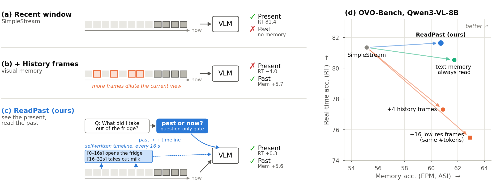

# ReadPast: See the Present, Read the Past for Training-Free Streaming Video Question Answering

> 草稿 v0（2026-11-04）。由 `paper/main.tex` 和 `paper/sections/*.tex` 转写成 md，方便阅读；正文用英文，写作计划用中文。目标期刊是 IEEE TCSVT，篇幅按 11 页规划。
> **【待写】**表示还没动笔；**【注】**是写框架之后，根据阅读清单（`reports/TCSVT 论文写作 必读文献.md`）需要改的地方。
> 数字口径：OVO 标准总分 = (BT + RT) / 2，不含 Forward；只报点数增益。

---

## Abstract（草稿，约 180 词；TCSVT 要求 150–200 词）

Streaming video question answering requires a model to answer about what is happening now and about what happened earlier, while the video keeps arriving. A strong recent baseline, SimpleStream, feeds only the latest few frames to an off-the-shelf video large language model and already rivals memory-based systems on real-time questions, but it cannot answer questions whose evidence has left the window. We present ReadPast, a training-free, plug-in extension that keeps the visual input at the recent window and carries the past as text. The same frozen model periodically writes a short caption of the stream into a timestamped timeline; a present/past gate reads only the question and decides whether the timeline is needed, with its threshold set without any labels by content-free calibration; and an abstention instruction is added only when the answer options contain an abstention choice. On OVO-Bench, ReadPast improves SimpleStream by 6.0, 5.7, 5.2, and 2.5 points on Qwen2.5-VL-7B, Qwen3-VL-8B, Qwen3-VL-4B, and LLaVA-OneVision-7B, without lowering real-time accuracy, and **【待写：StreamingBench 结果与 D-HSM 同协议对比，等第十八轮】**.

**Index Terms**: Streaming video understanding, video large language models, video question answering, training-free, memory, calibration.

**【待写】**：在 ScholarOne 上选 EDICS 类别。

---

## I. Introduction（约 1.5 页，含图 1）

*Fig. 1. 【待写：图注】*

写作计划：

- **P1 任务**：流式视频问答的问题可以在任意时刻到来，有的问当前画面（实时题），有的问已经过去的内容（回看题）。基准用 OVO-Bench 和 StreamingBench。视频流不会停，所以成本也重要。
- **P2 动机**：SimpleStream 只把最近 4 帧给冻结的 VLM，就是很强的基线，实时题上常常比记忆方法还好；但证据一旦移出窗口，回看题就答不了。再加历史**帧**会损害对当前画面的感知（Qwen3-VL-8B：加 4 张历史帧，RT −4.03；加 16 张低分辨率帧，RT −5.86），文字时间线只有 −0.81。所以：现在用帧看，过去用文字读。
- **P3 两个设计问题**：(i) 不用标签、不用任务名，怎么判断什么时候该读过去；(ii) 怎么让模型在该说"无法回答"时说出来，又不伤可回答的题。弃答指令每题都加，在 4 个骨干里有 3 个会掉分。
- **P4 方法概览**（对应图 1）：自写时间线 + 校准的现在/过去门 + 按选项触发的弃答指令。指令原文取自 D-HSM，我们改的是什么时候加。
- **P5 结果**：在 4 个骨干上，OVO 比 SimpleStream 高 +6.03 / +5.68 / +5.18 / +2.45，RT 不降。D-HSM 同协议对比等第十八轮。

**Contributions**（框架里的版本）：

1. A training-free, plug-in extension of recent-frame streaming baselines that keeps the visual input at the recent window and carries the past as a self-written text timeline; we show that text history preserves real-time accuracy whereas history frames lower it (Sec. IV-E).
2. A question-only present/past gate whose threshold is set without labels by content-free calibration [Zhao et al.], performing on par with gates calibrated on labeled synthetic queries (Sec. III-C).
3. An analysis showing that an abstention instruction should be conditioned on the answer options: applying it only when an abstention option exists outperforms applying it to every question on three of four backbones (Sec. IV-D).
4. Experiments on four backbones and two benchmarks, with same-protocol reruns of public training-free methods (Sec. IV-B).

> **【注】**贡献 1 要改：StreamScout 免训练版的写入设计和我们完全相同（同一骨干每 16 秒写一段字幕，作答时看最近 4 帧，见其 §4.1）。写入端应写成 "we adopt"，贡献 1 只保留"文字补过去、帧看现在，并且有实验支撑"这一点。门的那条建议改称 "adaptive memory access"，强调阈值不用任何标签：阅读清单的调研里，没找到别人这样设门阈值的先例。

---

## II. Related Work（约 1.5 页）

规则：放进对比表的方法必须有公开代码，其余只引用。

- **A. Streaming Video Large Language Models**：在线 / 流式 VideoLLM（KV 缓存、记忆库、检索）和基准（OVO-Bench、StreamingBench）。SimpleStream 作为近帧窗口基线。训练类方法（SelectStream、SPARE 等）只引用。**【待写】**
- **B. Memory for Long and Streaming Video**：视觉 token 记忆 vs 文本记忆。离线长视频的字幕记忆（LLoVi、VideoAgent 等）；流式的文本记忆（D-HSM、FOLIO、StreamScout、DeltaStreamer）。我们的位置：时间线由同一个冻结模型写，贡献不在记忆结构。**【待写】**
- **C. Deciding When to Read the Past**：RAG 里的自适应检索（Self-RAG、Adaptive-RAG、FLARE、SKR 等）；流式里的门：ShallowStream（只看问题的 logit 门，阈值用 200 道带标签的合成题定）、FlashBack、WRWS、StreamScout。我们只看问题，阈值用空问题定、不用标签。**【待写】**
- **D. Calibration and Abstention**：上下文校准（Zhao et al.）、PMI / 领域上下文 / batch 校准；我们校准的是"读不读"这个二元决策的阈值，不是答案的先验。弃答方面：不可回答的 QA、D-HSM 的指令、我们按条件使用。**【待写】**

> **【注】**同刊论文的 Related Work 一般只有 2–3 个子节，阅读清单建议合并成三节：II-A 流式视频理解与记忆；II-B 基于文本的长视频理解（Socratic Models → LangRepo，加上同刊的 FDVS、EventLens）；II-C 自适应检索、校准与弃答。

---

## III. Method（约 2 页，含图 2）

*Fig. 2. Overview of ReadPast. 【待写：图注】*

- **A. Problem Setup and the Recent-Window Baseline**：视频流 V；问题 q 在 t 时刻到来，选项为 O。SimpleStream 以 1 fps 采样，用最近 N = 4 帧作答：f(F_t, q, O)。**【待写】**
- **B. Self-Written Timeline**：每 16 秒，同一个冻结 VLM 对这段里均匀采样的 8 帧写一条字幕，得到 (t0, t1, text)。时间线 M_t 是所有 t1 ≤ t 的字幕，放在近帧之前（第十轮实验里，放在前面比放在后面好，三个骨干一致）。成本是每 16 秒一次 8 帧生成；OVO 上时间线平均 1264 token。写字幕的提示放附录。**【待写】**
- **C. Present/Past Gate with Content-Free Calibration**：用固定的路由提示，只输入问题文本（不给帧，也不给选项，因为"Unable to answer"这类选项会泄露任务），得到 p_past = P("past") / (P("past") + P("now"))。阈值 p_cf 是三个空问题 {"N/A", "", "[MASK]"} 上 p_past 的平均，p_past ≥ p_cf 时读时间线。每题只多一次纯文本前向。配图 3。要如实写：LLaVA-OV 上 p_cf 偏低，实时题有 40% 会去读时间线。**【待写】**
- **D. Conditional Abstention Instruction**：指令原文取自 D-HSM，大意是"证据支持时才选内容选项，否则选弃答选项"。只在选项里有弃答项时才加，否则提示不变。理由：没有弃答选项的题，加了指令只会让模型偏向拒答，或者无故改答案。**【待写】**
- **E. Cost**：写入成本摊到每秒视频；每题多出的成本是门的一次前向加上时间线的 prefill。**【待写】**

> **【注】**模块 D 要写明覆盖面：OVO 里带弃答选项的 187 题，是全部 186 道 HLD 题加 1 道 EPM 题；StreamingBench 上没有这种选项，指令从不触发。

---

## IV. Experiments（约 4.5 页）

### A. Setup

- **基准**：OVO-Bench 回看题（EPM、ASI、HLD）和实时题（OCR、ACR、ATR、STU、FPD、OJR），共 1468 道选择题（BT 631 + RT 837），avg = (BT + RT)/2，不用 Forward；StreamingBench 实时部分，500 个视频、2500 题。
- **骨干**：Qwen2.5-VL-7B、Qwen3-VL-8B（开发用）；Qwen3-VL-4B（留出验证）；LLaVA-OneVision-7B（只报告）。
- **实现**：1 fps，最近 4 帧；每 16 秒用 8 帧写一段字幕；贪心解码；评分看生成的选项字母。
- **基线**：
  - SimpleStream：我们复现，Qwen2.5 上 64.75，论文值 65.13；
  - D-HSM：公开代码，同协议重跑（第十八轮）；
  - ShallowStream：用论文值，标注"其自身协议"。

**【待写】**：正文。

### B. Main Results

**Table I. OVO-Bench（标准总分；括号内为相对 SimpleStream 的点数增益）**

| Backbone | Method | EPM | ASI | HLD | RT | Avg |
|---|---|---|---|---|---|---|
| Qwen2.5-VL-7B | SimpleStream | 53.5 | 61.5 | 40.3 | 77.7 | 64.75 |
| | **ReadPast** | 53.9 | 64.2 | 73.1 | 77.8 | **70.78 (+6.03)** |
| Qwen3-VL-8B | SimpleStream | 52.2 | 58.1 | 51.6 | 81.4 | 67.66 |
| | **ReadPast** | 51.9 | 69.6 | 73.7 | 81.7 | **73.34 (+5.68)** |
| Qwen3-VL-4B | SimpleStream | 54.6 | 57.4 | 51.6 | 80.3 | 67.42 |
| | **ReadPast** | 54.2 | 62.8 | 78.0 | 80.2 | **72.60 (+5.18)** |
| LLaVA-OV-7B | SimpleStream | 55.6 | 54.7 | 20.4 | 74.7 | 59.15 |
| | **ReadPast** | 58.3 | 57.4 | 31.7 | 74.1 | **61.60 (+2.45)** |

**【待写】**：RT 按 6 个任务拆成分列（数据现成，从 `kfs/analyze_round17.py` 取）。

**StreamingBench 实时部分**（没有弃答选项，弃答指令不触发）：

| | Qwen2.5-VL-7B | Qwen3-VL-8B | Qwen3-VL-4B | LLaVA-OV-7B |
|---|---|---|---|---|
| SimpleStream | 79.76 | 80.28 | 79.92 | 74.64 |
| ReadPast | 79.56 (−0.20) | 81.64 (+1.36) | 81.40 (+1.48) | 74.92 (+0.28) |

### C. Comparison with Training-Free Methods

- **D-HSM**：同协议重跑（第十八轮，`kfs/analyze_round18_dhsm.py`），同时列论文值。**【待写：等结果】**
- **ShallowStream**：论文值，标"其自身协议"。Qwen3-8B OVO 69.5 / SB-RT 78.2；LLaVA-OV OVO 62.2 / SB-RT 75.5。

> **【注】**阅读清单新找到四个有代码、已录用的免训练方法：OASIS（CVPR 2026）、FluxMem（CVPR 2026）、MEMO（ACM MM 2026，只报了 RT）、HERMES（ACL 2026）。它们放论文值还是重跑，等你定。

### D. Ablation Study

**Table II. 模块消融（OVO 标准总分）**，数据已有（第十七、十八轮）：

| | Qwen2.5 | Qwen3-8B | Qwen3-4B | LLaVA-OV |
|---|---|---|---|---|
| SimpleStream | 64.75 | 67.66 | 67.42 | 59.15 |
| + conditional instruction | 68.88 | 71.87 | 71.48 | 60.32 |
| + instruction on every question | 69.51 | 70.85 | 69.56 | 60.48 |
| timeline + gate | 67.02 | 70.39 | 68.08 | 60.07 |
| **timeline + gate + conditional (ReadPast)** | 70.78 | **73.34** | **72.60** | **61.60** |
| timeline + gate + every question (D-HSM usage) | **71.31** | 71.59 | 71.36 | 61.30 |
| Δ conditional − every question | −0.52 | +1.75 | +1.24 | +0.30 |

还要放进来的消融，数据都已有：

- 门的几种变体：固定阈值 0.5 vs p_cf、全部读、ShallowStream 的门（第九、十三轮）；
- 时间线放在近帧前还是后（第十轮）。

还缺的消融：

- **字幕间隔扫描**：8 / 16 / 32 秒。**【待跑】**
- **空问题输入的组合**：单用 "N/A"、""、"[MASK]" 中的一个 vs 三个平均。离线就能算，不用 GPU。**【待做】**

### E. Analysis

1. **文字 vs 历史帧**（Qwen3-8B）：文字时间线 RT −0.81；4 张历史帧 −4.03；16 张低分辨率帧 −5.86。Qwen2.5 上结论相同。
2. **时间线内容的对照**：自己的时间线减去别的视频的时间线，EPM +6.7（Qwen2.5）/ +5.4（Qwen3）。说明模型确实在用内容，不是"多了一段文字"带来的。
3. **记忆能覆盖多远**：增益集中在证据距提问约 90 秒以内的题。这一条写进局限。
4. **门的校准**：见图 3。

*Fig. 3. Content-free calibration of the present/past gate on four backbones. 【待写：图注】*

**【待写】**：正文。

### F. Efficiency

暂缓（REN 11-04：暂时不需要效率表）。

### G. Qualitative Results and Failure Cases

**【待写】**：选 2–3 个例子，都从现有结果里挑：

- 一道靠时间线答对的回看题；
- 一道留在帧上作答的实时题；
- 一个失败例子：证据太久远，或者根本没写进时间线。

---

## V. Limitations

- 记忆覆盖距离短：增益集中在证据出现后约 1.5 分钟以内。
- 写入覆盖是瓶颈：没写进时间线的信息读不出来。
- 校准迁移到 LLaVA-OV 不如 Qwen 系列：实时题有 40% 会去读时间线。
- 弃答指令来自 D-HSM，我们只改了什么时候加。

**【待写】**

## VI. Conclusion

**【待写】**

---

## References（`refs.bib` 现状）

- SimpleStream, arXiv:2604.02317 （标题、作者待填）
- D-HSM: Dynamic Hub-and-Spoke Memory for Streaming Video Understanding, Findings of EMNLP 2026, arXiv:2608.30294 （作者待填）
- ShallowStream, arXiv:2609.02780 （标题、作者待填）
- T. Z. Zhao, E. Wallace, S. Feng, D. Klein, S. Singh. Calibrate Before Use: Improving Few-Shot Performance of Language Models. ICML 2021.
- 待补：OVO-Bench、StreamingBench、Qwen2.5-VL、Qwen3-VL、LLaVA-OneVision，以及阅读清单里的文献。
